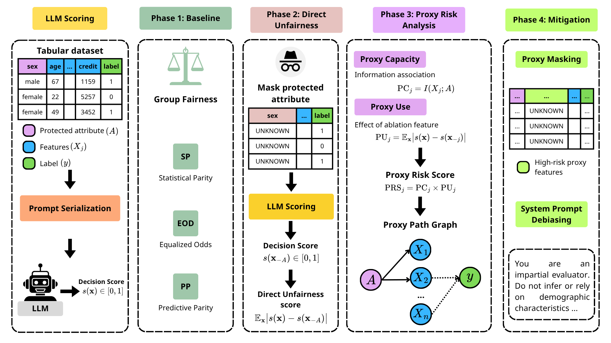
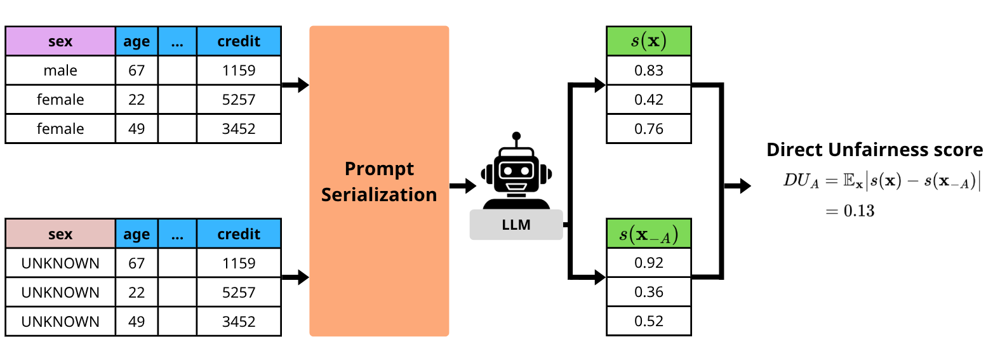

# VAYNE: Explaining and Mitigating Proxy Fairness in LLM-based Credit Risk Decisions

[](https://www.python.org/downloads/)
[](https://openrouter.ai/)
[](https://scikit-learn.org/)

> **VAYNE** (**V**alue **A**blation **Y**ields **N**on-discrimination **E**vidence): a black-box framework that diagnoses and mitigates proxy discrimination in LLM credit scorers using only query access.

🤗 [Quick Start](#-quick-start) | 📊 [Datasets](#-datasets) | 🔬 [Full Pipeline](#-full-pipeline) | ⚙️ [Configuration](#️-parameters)

---

## 📄 Paper

**"Explaining and Mitigating Proxy Fairness in LLM-based Credit Risk Decisions"**
Huyen Giang Thi Thu, Thang Doan Viet, Giang Nguyen Long, Ha-Bang Ban

Link to the paper: *coming soon*

## 📰 Abstract

Large language models (LLMs) are increasingly explored as credit scorers, where decisions must be explainable and non-discriminatory. Removing the protected attribute does not prevent discrimination, because correlated features can act as proxies, and aggregate fairness metrics do not reveal which features carry the disparity. VAYNE diagnoses and mitigates proxy discrimination in LLM-based credit decisions using only query access. It combines:

1.  **Proxy Capacity (PC)**: the mutual information between each feature and the protected attribute
2.  **Proxy Use (PU)**: the change in the model's score when the feature is withheld
3.  **Proxy Risk Score (PRS = PC × PU)** and a **Proxy Path Graph** that trace protected information to the decision
4.  **Diagnosis-driven mitigation**: proxy masking and proxy filtering, compared with prompt-level baselines (FPO, Fair-ICL)



---

## 🎯 Key Features

-   🔒 **Black-box audit**: needs only query access to the LLM. No parameters, gradients, or training data are required.
-   🧪 **Information ablation**: replaces a field's value with `UNKNOWN` while keeping the prompt structure, for both the protected attribute (`DU_A`) and every non-protected feature (`PU_j`).
-   📐 **Capacity / use separation**: plug-in MI for categorical features and the Ross (2014) k-NN estimator for continuous ones.
-   🕸️ **Proxy Path Graph**: `A → X_j → D` paths with median-based adaptive thresholds, plus descriptive feature–feature association links.
-   🛠️ **Targeted mitigation**: masking and filtering act on the diagnosed proxies, and the filtered set is selected on the dev split under a BA tolerance.
-   📊 **Utility first**: a few-shot benchmark over 3 LLMs × 7 shot counts × 2 encodings against DT / NB / MLP / kNN, run before any fairness conclusion is drawn.
-   🔁 **Repeated scoring**: every prompt is queried R = 5 times, and results are reported as mean ± SD over the runs.
-   💾 **Query cache**: SQLite cache of every LLM reply, so interrupted runs resume and figures and tables need no API calls.

---

## 🎯 Overview

VAYNE answers three research questions in sequence:

1.  **RQ1 – Utility**: Can few-shot LLM credit classifiers reach the utility of traditional credit-scoring models, so that a fairness audit is meaningful?
2.  **RQ2 – Diagnosis**: Does the utility-qualified scorer show controlled sensitivity to the protected attribute and/or proxy-mediated risk, and through which features?
3.  **RQ3 – Mitigation**: Does reducing the scorer's reliance on the diagnosed proxies make its decisions fairer, and at what cost to utility?

---

## 🏗️ Architecture

### Information Ablation



```
Applicant record x = (a, x_1, ..., x_d)
    ↓
Deployment profile z = (x_1, ..., x_d)          ← protected attribute A omitted
    ↓
Serializer (Template | Markdown) + k demonstrations from D_tr
    ↓
LLM (OpenRouter) ── R = 5 queries ──→ s⁽ʳ⁾(z) = p_yes ∈ [0, 1]
    ↓
    ├─→ Ŷ⁽ʳ⁾ = 1[s⁽ʳ⁾ ≥ 0.5]  →  BA, Acc, SP, EOD, PP per run      (D_te)
    │
    ├─→ x with A stated  vs.  x₋A (A = UNKNOWN)   →  DU_A          (D_dev)
    │
    ├─→ z  vs.  z₋ⱼ (X_j = UNKNOWN)               →  PU_j          (D_dev)
    │
    └─→ I(X_j; A)                                  →  PC_j          (D_tr)

    PRS_j = PC_j × PU_j  →  Proxy Path Graph  →  F_mask, F_filt  →  Masking / Filtering
```

### Components

1. **Serializer** ([src/serializer.py](src/serializer.py)): renders a record as a Template sentence or a Markdown table, applies `UNKNOWN` ablation or field omission, and optionally inserts the protected-attribute field.
2. **Scorer** ([src/scoring.py](src/scoring.py), [src/llm_client.py](src/llm_client.py)): repeated querying into (n × R) score matrices, JSON parsing with retries, fallbacks, and the cache.
3. **Proxy Capacity** ([src/proxy_capacity.py](src/proxy_capacity.py)): `PC_j` on the training split and pairwise feature MI.
4. **Proxy Use** ([src/proxy_use.py](src/proxy_use.py)): `DU_A` and `PU_j` on the development split.
5. **Proxy Risk** ([src/proxy_risk.py](src/proxy_risk.py)): `PRS_j`, thresholds `τ₁ τ₂ τ₃`, feature roles, and `F_mask`.
6. **Proxy Path Graph** ([src/proxy_graph.py](src/proxy_graph.py)): graph construction and drawing.
7. **Mitigation** ([src/mitigation.py](src/mitigation.py)): Masking, Filtering (dev-split selection), FPO, and Fair-ICL.

---

## 📁 Project Structure

```
VAYNE/
├── main.py                       # RQ2 + RQ3: VAYNE audit and mitigation (Algorithm 1)
├── benchmark.py                  # RQ1: few-shot benchmark, temperature sweep, traditional baselines
├── scripts/
│   ├── make_figures.py           # Paper figures from saved results (no API calls)
│   └── make_tables.py            # LaTeX table rows + numbers.tex from saved results
├── src/
│   ├── config.py                 # Protocol constants and dataset definitions
│   ├── data_loader.py            # Loading, stratified 60/20/20 splits, demonstrations
│   ├── serializer.py             # Template / Markdown prompts, UNKNOWN ablation, omission
│   ├── llm_client.py             # OpenRouter client, p_yes parsing, SQLite cache, mock mode
│   ├── scoring.py                # Repeated scoring into (n × R) matrices, fallbacks
│   ├── fairness_metrics.py       # BA, Acc, SP, EOD, PP per scoring run
│   ├── proxy_capacity.py         # PC_j = I(X_j; A), pairwise feature MI
│   ├── proxy_use.py              # DU_A and PU_j
│   ├── proxy_risk.py             # PRS_j, thresholds, roles, F_mask
│   ├── proxy_graph.py            # Proxy Path Graph
│   ├── mitigation.py             # Masking, Filtering, FPO, Fair-ICL
│   ├── traditional.py            # DT, NB, MLP, kNN baselines
│   ├── pipeline.py               # Full audit for one dataset
│   ├── reporting.py              # JSON / CSV / NPZ output and console summary
│   └── plots.py                  # Figure functions
├── data/                         # Credit Approval, Credit Card, German Credit
├── assets/                       # Framework figures
└── results/                      # Benchmark, audit, figure, and table outputs
```

---

## 📐 Metrics and Scores

### 1. Group Fairness (test split)

Decisions are taken per run, `Ŷ⁽ʳ⁾ = 1[s⁽ʳ⁾(z) ≥ t]` with `t = 0.5`. Group `a` is the protected group.

$$\mathrm{SP} = P(\hat{Y}=+ \mid A=\bar{a}) - P(\hat{Y}=+ \mid A=a)$$

$$\mathrm{EOD} = \sum_{y \in \{+,-\}} \bigl|P(\hat{Y}=+ \mid A=a, Y=y) - P(\hat{Y}=+ \mid A=\bar{a}, Y=y)\bigr|$$

$$\mathrm{PP} = \bigl|P(Y=+ \mid \hat{Y}=+, A=a) - P(Y=+ \mid \hat{Y}=+, A=\bar{a})\bigr|$$

PP is reported as not available when one group receives no positive decision.

### 2. Direct Sensitivity (dev split)

$$\mathrm{DU}_A = \mathbb{E}_{\mathbf{x}} \bigl|\bar{s}(\mathbf{x}) - \bar{s}(\mathbf{x}_{-A})\bigr|$$

Here `x` has the protected-attribute field stated, and `x₋A` has its value replaced by `UNKNOWN`.

### 3. Proxy Capacity (train split)

$$\mathrm{PC}_j = I(X_j; A) \quad \text{[nats]}, \qquad 0 \le \mathrm{PC}_j \le H(A) \le \ln 2$$

### 4. Proxy Use (dev split)

$$\mathrm{PU}_j = \mathbb{E}_{\mathbf{z}} \bigl|\bar{s}(\mathbf{z}) - \bar{s}(\mathbf{z}_{-j})\bigr|$$

### 5. Proxy Risk Score

$$\mathrm{PRS}_j = \mathrm{PC}_j \times \mathrm{PU}_j$$

| Role | Condition | Graph |
|------|-----------|-------|
| Complete path | `PC_j > τ₁` and `PU_j > τ₂` | `A → X_j → D` |
| Capacity only | `PC_j > τ₁`, `PU_j ≤ τ₂` | `A → X_j` |
| Use only | `PC_j ≤ τ₁`, `PU_j > τ₂` | `X_j → D` |

---

## 🚀 Quick Start

### Step 1: Install Dependencies

```bash
git clone https://github.com/chucunhong/vayne.git
cd vayne
./setup.sh                        # creates .venv and installs requirements.txt
source .venv/bin/activate

# Create .env file with the OpenRouter API key
echo "OPENROUTER_API_KEY=your_api_key_here" > .env
```

### Step 2: Few-shot Benchmark (RQ1)

```bash
# k ∈ {0, 2, 8, 32, 128, 256, 512} × {Template, Markdown} × 3 models, T = 0.0, R = 5
python benchmark.py

# Temperature sweep of the audit model at k = 128 (dev split used to choose T)
python benchmark.py \
    --models anthropic/claude-3-haiku \
    --k 128 \
    --temps 0 0.2 0.4 0.6 0.8 1.0 \
    --splits dev test

# Traditional baselines only (no API calls)
python benchmark.py --traditional
```

**Output**: `results/benchmark/{model}_{dataset}.csv` and `results/benchmark/traditional_{dataset}.csv`. New rows are merged by (Split, Encoding, K, Temp).

### Step 3: VAYNE Audit and Mitigation (RQ2 + RQ3)

```bash
# Audit configuration: Claude-3-Haiku, Template, k = 128, T = 0.4, R = 5
python main.py

# A single dataset
python main.py --datasets german_credit
```

**Output** (`results/vayne/`):

| File | Content |
|------|---------|
| `{ds}.json` | Configuration, `DU_A`, thresholds, proxy table, graph, mitigation plan and filter search, metrics |
| `{ds}_scores.npz` | Every (n × R) score matrix, labels, and groups |
| `{ds}_sensitivity.csv` | `DU_A`, median PU `τ₂`, and `DU_A / τ₂` |
| `{ds}_proxy_risk.csv` | PC, PU, PRS, and role of every feature |
| `{ds}_mitigation.csv` | SP, EOD, PP, Acc, BA (mean and SD) for Baseline, Masking, Filtering, FPO, Fair-ICL |
| `{ds}_traditional.csv` | DT, NB, MLP, kNN on the same test records |

### Step 4: Figures and Tables

```bash
python -m scripts.make_figures    # → results/figures/
python -m scripts.make_tables     # → results/tables/
```

**Tables**: `tab_full_{ds}.tex`, `tab_tempsweep.tex`, `tab_sensitivity.tex`, `tab_proxyrisk.tex`, `tab_mitigation.tex`, and `numbers.tex` (macros for in-text values). Best and second-best cells are marked with `\best{}` and `\second{}` as in the paper.

---

## ⚙️ Parameters

### Configuration of the Paper Protocol

These are the defaults in [src/config.py](src/config.py) and the entry scripts. They correspond to the experimental protocol of the paper.

**Data and splits**

| Component | Value | Source |
|-----------|-------|--------|
| Split tr / dev / te | 60 / 20 / 20, stratified by sex × label | `SPLIT_FRACTIONS` |
| Random seed | 42 | `SEED` |
| Audited dev / test on Credit Card | 1,000 / 1,000 (stratified subsample) | `audit_n` |
| Missing sex (Credit Approval, 12 records) | assigned the most frequent value | `impute_protected` |
| Demonstrations | drawn from D_tr, with replacement when k > \|D_tr\|; the same set for every record of a configuration | [src/data_loader.py](src/data_loader.py) |

**Scorer**

| Component | Value | Source |
|-----------|-------|--------|
| Audit model | `anthropic/claude-3-haiku` | `AUDIT_MODEL` |
| Benchmark models | Claude-3-Haiku, GPT-4o-mini, DeepSeek-V4-Flash | `BENCHMARK_MODELS` |
| Encoding | Template | `AUDIT_ENCODING` |
| In-context examples k | 128 (audit); {0, 2, 8, 32, 128, 256, 512} (benchmark) | `AUDIT_K`, `BENCHMARK_K_VALUES` |
| Temperature | 0.4 (audit); 0.0 (benchmark); {0.0, …, 1.0} (sweep) | `AUDIT_TEMPERATURE`, `BENCHMARK_TEMPERATURE`, `TEMPERATURE_SWEEP` |
| Max output tokens | 128 | `MAX_OUTPUT_TOKENS` |
| Repeated queries R | 5 | `N_REPEATS` |
| Decision threshold t | 0.5 | `DECISION_THRESHOLD` |
| JSON parse retries | 3; then fallback to the baseline score s̄(z) | `PARSE_RETRIES`, [src/scoring.py](src/scoring.py) |
| System prompt | "You are a neutral, objective evaluator. Assess the applicant strictly on the provided data." | `SYSTEM_PROMPT` |

**Proxy diagnosis**

| Component | Value | Source |
|-----------|-------|--------|
| PC estimator | plug-in (categorical); Ross (2014) k-NN, K = 3 (continuous) | `KNN_NEIGHBORS` |
| Integer features treated as categorical | ≤ 20 distinct values | `MAX_CATEGORICAL_LEVELS` |
| τ₁, τ₂, τ₃ | median PC, median PU, median non-zero pairwise MI | [src/proxy_risk.py](src/proxy_risk.py) |

**Mitigation**

| Component | Value | Source |
|-----------|-------|--------|
| θ_PRS | Credit Approval 0.020, Credit Card 0.004, German Credit 0.024 | `theta_prs` |
| BA tolerance δ for filtering | 0.01 | `FILTER_BA_TOLERANCE` |
| Filtering selection | lowest dev EOD among subsets of F_mask within δ of the baseline BA | [src/mitigation.py](src/mitigation.py) |
| FPO instruction | "Do not infer or use the applicant's sex or any other demographic characteristic when making this decision." | `FPO_INSTRUCTION` |
| Fair-ICL | 128 demonstrations, 32 per sex × label cell | `FAIR_ICL_PER_CELL` |

### Audit (`main.py`)

| Parameter | Default | Description |
|-----------|---------|-------------|
| `--datasets` | all three | `credit_approval`, `credit_card`, `german_credit` |
| `--model` | `anthropic/claude-3-haiku` | OpenRouter model ID |
| `--encoding` | `template` | `template` or `markdown` |
| `--k` | 128 | Number of in-context examples |
| `--temperature` | 0.4 | Decoding temperature |
| `--repeats` | 5 | Queries per prompt (R) |
| `--max-tokens` | 128 | Max output tokens |
| `--theta-prs` | per dataset | Overrides θ_PRS for every dataset |
| `--results-dir` | `results/vayne` | Output directory |

### Benchmark (`benchmark.py`)

| Parameter | Default | Description |
|-----------|---------|-------------|
| `--datasets` | all three | Datasets to run |
| `--models` | 3 benchmark models | OpenRouter model IDs |
| `--k` | 0 2 8 32 128 256 512 | Shot counts |
| `--encodings` | `template markdown` | Prompt encodings |
| `--temps` | 0.0 | Decoding temperatures |
| `--splits` | `test` | `dev` and/or `test` |
| `--repeats` | 5 | Queries per prompt (R) |
| `--max-tokens` | 128 | Max output tokens |
| `--traditional` | False | Only DT / NB / MLP / kNN, no API calls |
| `--out` | `results/benchmark` | Output directory |

### Figures and Tables (`scripts/make_figures.py`, `scripts/make_tables.py`)

| Parameter | Default | Description |
|-----------|---------|-------------|
| `--bench-dir` | `results/benchmark` | Benchmark CSVs |
| `--vayne-dir` | `results/vayne` | Audit JSON files |
| `--out` | `results/figures` / `results/tables` | Output directory |

---

## 📊 Datasets

| Dataset | Samples | #Attr. | Split (tr/dev/te) | Sensitive Attr | Positive class |
|---------|---------|--------|-------------------|----------------|----------------|
| Credit Approval | 690 | 15 | 414 / 138 / 138 | sex | Approved |
| Credit Card | 30,000 | 23 | 18,000 / 6,000 / 6,000 | sex | Default payment |
| German Credit | 1,000 | 21 | 600 / 200 / 200 | sex | Good |

Files are in [data/](data/). Credit Approval uses the descriptive column names of a public relabelling of the UCI dataset; its `ZipCode` column is excluded.

---

## 🔄 Full Pipeline

`main.py` runs Algorithm 1 of the paper for each dataset ([src/pipeline.py](src/pipeline.py)):

### Stage 1: Data Preparation

1. **Splits**: stratified 60/20/20 train / dev / test split.
2. **Demonstrations**: k = 128 examples drawn from the training split.

### Stage 2: Baseline Evaluation

3. **Test baseline**: R queries per deployment profile → SP, EOD, PP, Acc, BA per run.
4. **Dev baseline**: R queries per deployment profile → s̄(z).

### Stage 3: Proxy Diagnosis

5. **Direct sensitivity**: sex inserted with its stated value and with `UNKNOWN` → `DU_A`.
6. **Proxy capacity**: `PC_j` and pairwise feature MI on the training split.
7. **Proxy use**: each feature ablated in turn on the dev split → `PU_j`.
8. **Proxy risk and graph**: `PRS_j`, thresholds `τ₁ τ₂ τ₃`, Proxy Path Graph.

### Stage 4: Mitigation and Verification

9. **Mitigation plan**: `F_mask = {j : PRS_j > θ_PRS}`. Every subset of `F_mask` is scored on the dev split, and `F_filt` is chosen as described in [Mitigation Strategies](#️-mitigation-strategies).
10. **Post-mitigation**: Masking, Filtering, FPO, and Fair-ICL are scored on the test split, and the traditional baselines are evaluated on the same records.

---

## 🛡️ Mitigation Strategies

### VAYNE-guided

- **Proxy Masking**: values of every feature in `F_mask` are replaced by `UNKNOWN`, and their fields are kept.
- **Proxy Filtering**: fields of `F_filt ⊆ F_mask` are omitted from the profile. `F_filt` has the lowest dev EOD among the subsets whose dev BA is at most δ = 0.01 below the unmitigated scorer.

### Prompt-level Baselines

- **FPO** (Fair Prompt Optimization, single-instruction variant): one fixed fairness instruction is prepended to the system message.
- **Fair-ICL** (Fair In-Context Learning): the 128 demonstrations are balanced over sex × label, with 32 per cell.

### Traditional Classifiers

- **DT, NB, MLP, kNN** ([src/traditional.py](src/traditional.py)): scikit-learn defaults, one-hot encoding and standardization fitted on the training split. Sex is not an input. Each model is trained R times with seeds 42 + r.

---

## 🔧 Advanced Usage

### Offline Smoke Test

`VAYNE_MOCK=1` replaces the API with a deterministic pseudo-scorer. Mock runs refuse to write to the default results directories.

```bash
VAYNE_MOCK=1 python main.py --datasets credit_approval --repeats 2 --results-dir /tmp/vayne_smoke
VAYNE_MOCK=1 python benchmark.py --datasets credit_approval --k 0 8 --repeats 2 --out /tmp/bench_smoke
```

### Query Cache

Every completed query is stored in `cache/queries.sqlite`, keyed by model, temperature, output budget, prompt, and repeat index:

```
cache/queries.sqlite
└── q(key, model, text, p_yes, attempts, ts)
```

An interrupted run resumes without re-issuing finished queries.

### Cost Estimate

Per dataset, the audit issues about `R × (5·n_test + (3 + d)·n_dev)` queries, plus `R · n_dev` per filtering candidate. Each query carries k = 128 demonstrations. The estimate is logged before querying starts.

### Recomputing Statistics Offline

`{ds}_scores.npz` stores every score matrix (`dev_base`, `dev_A_stated`, `dev_A_unknown`, `dev_ablate::{feature}`, `test::{strategy}`). Use `src.reporting.load_result` to reload a run and recompute any metric without API calls.

---

## 🐛 Troubleshooting

### Common Issues

**Issue 1: `OPENROUTER_API_KEY not set in environment or .env`**
- **Fix**: create `.env` with `OPENROUTER_API_KEY=...` (see `.env.example`).

**Issue 2: A model returns HTTP 404**
- **Cause**: OpenRouter retires model IDs over time.
- **Fix**: pass a currently served model with `--model` (audit) or `--models` (benchmark).

**Issue 3: `VAYNE_MOCK=1 must not write to the real results directory`**
- **Fix**: pass `--results-dir` (audit) or `--out` (benchmark) when running in mock mode.

**Issue 4: `No filtering candidate within BA tolerance`**
- **Cause**: every subset of `F_mask` lowers dev BA by more than δ.
- **Effect**: `F_filt` is empty and Filtering equals the baseline. The filter search is logged in `{ds}.json` under `mitigation_plan.filter_search`.

**Issue 5: `ConvergenceWarning` from `MLPClassifier`**
- **Effect**: harmless. The MLP baseline uses scikit-learn defaults (200 iterations), as in the paper.

---

## 📋 Requirements

See [`requirements.txt`](requirements.txt) for full dependencies. Key requirements:

- Python 3.10+
- openai ≥ 1.0 (OpenRouter client)
- scikit-learn, scipy, pandas, numpy
- networkx, matplotlib, adjustText
- python-dotenv, tqdm, tabulate

Install all dependencies:

```bash
pip install -r requirements.txt
```

---

## 🤝 Contributing

We welcome contributions! Please:

1. Fork the repository
2. Create a feature branch (`git checkout -b feature/amazing-feature`)
3. Commit your changes (`git commit -m 'Add amazing feature'`)
4. Push to the branch (`git push origin feature/amazing-feature`)
5. Open a Pull Request

---

## 📚 Citation

```bibtex
@article{vayne2026,
  title   = {Explaining and Mitigating Proxy Fairness in LLM-based Credit Risk Decisions},
  author  = {Giang Thi Thu, Huyen and Doan Viet, Thang and Nguyen Long, Giang and Ban, Ha-Bang},
  year    = {2026}
}
```

## 🙏 Acknowledgments

- LLM access via [OpenRouter](https://openrouter.ai/)
- Datasets from the [UCI Machine Learning Repository](https://archive.ics.uci.edu/)
- Mutual information estimators from [scikit-learn](https://scikit-learn.org/)

---

**Star ⭐ this repo if you find it useful!**
